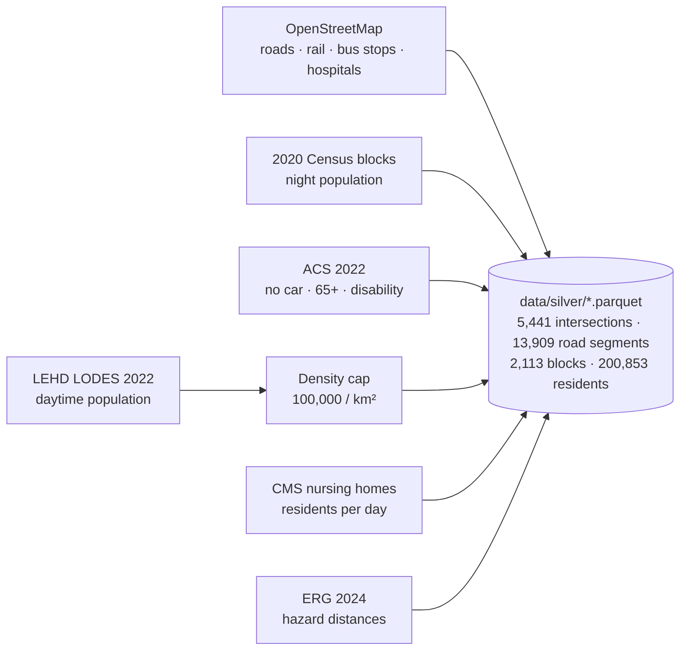
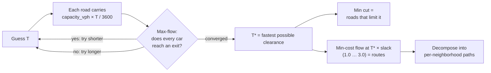
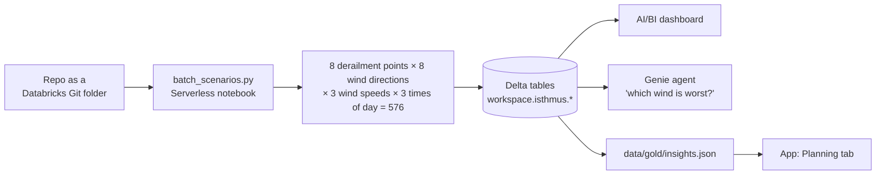
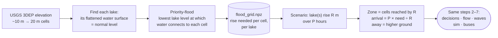

<div align="center">

# Isthmus

### When a train derails in downtown Madison, who should run, and who should stay inside?

Drop a chlorine or ammonia derailment on any rail line through Madison's isthmus. In about a second, Isthmus
draws the official danger zone, decides **block by block who evacuates and who shelters in place**, staggers
departures so the few roads out don't gridlock, and routes buses to residents without a car, each pickup
scheduled **before the gas reaches them**. Then it runs **576 scenarios on Databricks** to find what holds
across every derailment, wind and time of day. Flip the switch to **Flood** and the same engine plans for Lake
Mendota and Lake Monona rising over the isthmus, using real elevation data.


[](requirements.txt)
[](engine/flow.py)
[](data/databricks/batch_scenarios.py)
[](backend/main.py)
[](frontend/package.json)
[](engine/tests)

[Features](#features) · [How it works](#how-it-works) · [Results](#results) · [Built with](#built-with) · [Run it](#run-it) · [Limits](#known-limits) · [Full findings](docs/findings.md) · [Methods](docs/methods.md)

</div>

<!-- Add a screenshot of the ▶ Demo map here:  -->

---

<table>
<tr>
<td align="center" width="25%"><h2>576</h2>derailment scenarios on Databricks, 0 failures<br/><sub>~1 s each on a 5,441-intersection network</sub></td>
<td align="center" width="25%"><h2>75%</h2>of scenarios put Capitol Lakes nursing home in the danger zone<br/><sub>Meriter Hospital 62%</sub></td>
<td align="center" width="25%"><h2>52%</h2>of scenarios put Metro's bus garage in the danger zone<br/><sub>where every evacuation bus starts</sub></td>
<td align="center" width="25%"><h2>105 → 40 min</h2>to get every car out, light wind vs. strong wind<br/><sub>but strong wind means most people must shelter</sub></td>
</tr>
</table>

## Why

Downtown Madison sits on a strip of land about a kilometer wide between Lake Mendota and Lake Monona. Rail lines
run straight through it, past the Capitol, hospitals and nursing homes, and only a handful of roads lead out.

Most evacuation plans assume everyone has a car and everyone should leave. For a toxic gas, that's wrong twice:

- **Driving out can be more dangerous than staying in.** If the gas reaches your block before you could drive
  clear of it, you're safer indoors with the windows shut. The Emergency Response Guidebook says so too.
- **Not everyone can leave on their own.** Households without a car, people with disabilities, seniors and
  nursing-home residents need a ride, and that ride has a deadline: the moment the gas arrives.

We dug into both, with real Madison data, and asked where plans break.

## Features

| | |
|---|---|
| ☣️ **Official danger zones** | DOT Emergency Response Guidebook 2024: the isolation circle plus the downwind protective-action area, with **rail tank car** distances that change with wind speed (chlorine at night in light wind: 7+ miles). |
| 🏠 **Evacuate or shelter, block by block** | A block evacuates only if its residents can get out before the gas arrives: warning time plus travel time to the nearest safe exit, with a congestion margin. Otherwise it's told to stay inside. |
| 🚦 **Capacity-aware departure waves** | Highest-risk neighborhoods leave first, in 10-minute waves that each fit through every exit and bottleneck, so the roads don't gridlock. |
| 🛣️ **Provably capacity-limited clearance time** | Max-flow with a binary search over time gives the fastest any plan could clear everyone, and the min cut names the roads that limit it. Min-cost flow assigns the routes. |
| 🚌 **Bus pickups with deadlines** | OR-Tools vehicle routing from Metro's garage to a shelter outside the danger area. Every pickup is scheduled before the gas reaches that stop; if no bus could make it, those residents shelter instead of being promised a ride. |
| 🚗 **Live traffic simulation** | A link-queue model in 30 s steps shows where and when roads back up, and the map animates it. |
| 💬 **"Why?" for everything** | Click any block or bus for a plain-English reason, e.g. *"Gas arrives in 9 min, getting out would take 14 min"* → shelter in place. |
| 🔀 **Compare mode** | Pin a scenario's summary, then change anything and see the difference, e.g. 20 buses vs. 5, or a normal day vs. game day. |
| ▶️ **Guided demo** | Four steps that tell the story: who leaves, faster wind, game day, too few buses. |
| 📊 **Planning tab** | The 576-scenario findings in the app: facility exposure, recurring choke points, wind direction and time of day. |
| ⚙️ **Every assumption visible** | Every tunable number lives in one file ([`engine/assumptions.py`](engine/assumptions.py)) and is shown in the Assumptions tab. |
| 🌊 **Floods too** | Switch the hazard to **Flood**: Lake Mendota, Lake Monona or both rise by up to 3 m over hours. USGS elevation and a priority-flood algorithm decide where water can actually reach; flooded roads close and everything else re-plans. |
| 🧱 **Contraflow** | Turn major roads all-outbound and re-plan. (Road closures are supported by the engine and API.) |
| 🧭 **Explained in the app** | A first-visit welcome, a How it works tab and help tips on every control. |

## How it works

### 1. Build Madison: real public data, cleaned



[`data/build_silver_osm.py`](data/build_silver_osm.py) pulls everything for a 15 × 12 km study area that reaches
out to the Beltline, so evacuees have real exits, and writes GeoParquet "silver" tables in a shared schema
([`contracts/data_schema.md`](contracts/data_schema.md)). OpenStreetMap is missing lane counts on 72% of edges and
speeds on 67%, so those are filled by road class. LODES had a surprise for us (see [Results](#results)).

### 2. Plan one scenario: seven steps, about a second

```mermaid
flowchart LR
    P["Derailment point<br/>chemical · spill · wind<br/>time of day · buses"] --> HZ["1 · Hazard zone<br/>ERG isolation circle +<br/>downwind square"]
    HZ --> RR["2 · Road rules<br/>inside the zone: away only<br/>no entering from outside"]
    RR --> DEC["3 · Evacuate or shelter<br/>can this block beat<br/>the gas?"]
    DEC --> FLOW["4 · Clearance time<br/>max-flow + binary search<br/>min-cost routes"]
    FLOW --> WAVE["5 · Departure waves<br/>fit every bottleneck"]
    WAVE --> SIM["6 · Traffic simulation<br/>link queues, 30 s steps"]
    SIM --> BUS["7 · Bus routing<br/>OR-Tools VRP with<br/>gas-arrival deadlines"]
    BUS --> OUT(["Plan: zone · decisions · routes<br/>waves · buses · timeline"])
```



1. **Hazard zone** ([`hazard.py`](engine/hazard.py)). The ERG isolation circle around the release plus a
   downwind protective-action square, with the release at the middle of its upwind edge. Large spills use ERG
   Table 3 rail tank car values for the wind band (low < 6 mph, moderate 6–12, high > 12). Gas arrival at any
   point = distance ÷ wind speed.
2. **Road rules** ([`evacgraph.py`](engine/evacgraph.py)). Roads inside the zone stay open, since people inside
   have to drive out on them, but only in directions moving *away* from the release. Entering the zone is
   blocked. Exits are intersections just outside the zone plus a 300 m buffer.
3. **Who is where, and who can leave** ([`population.py`](engine/population.py),
   [`decisions.py`](engine/decisions.py)). Each Census block gets residents present (night or day), visitors
   (workers, the game-day crowd), car-free residents, and people who need a bus: car-free × (disability share +
   ½ × 65+ share), plus every nursing-home resident. A block evacuates only if 5 min warning + free-flow time to
   an exit × 1.5 beats the gas.
4. **Clearance time and routes** ([`flow.py`](engine/flow.py)). See [the units problem](#the-hard-part-rates-vs-counts)
   below.
5. **Departure waves** ([`waves.py`](engine/waves.py)). Earliest gas arrival leaves first. Within a 10-minute
   bucket, blocks closer to an exit go first. Each wave fits within the capacity of every exit and bottleneck.
6. **Traffic simulation** ([`sim.py`](engine/sim.py)). Each road has a travel time and an outflow capacity, and
   cars queue when it's full. It reports the "everyone out" time, when each road backs up, and queued
   vehicle-minutes per road, which is how we rank choke points.
7. **Buses** ([`buses.py`](engine/buses.py)). Pickup stops are the nearest Metro stop within 400 m of each block
   that needs help. OR-Tools solves a capacitated vehicle routing problem with **time windows that close when the
   gas arrives**, using congested travel times from the simulation, from the Metro garage to the closest
   candidate shelter outside the danger area.

### The hard part: rates vs. counts

Road capacity is a **rate** (cars per hour), but evacuees are a **count** (cars). You can't push a count through
a rate. So for a candidate duration *T*, every road gets capacity × *T* / 3600 cars, and we ask OR-Tools'
max-flow whether every car reaches an exit:



At exactly *T\** the min-cost flow is forced into long detours, so we also try *T\** × 1.0, 1.1, 1.25, 1.5, 2 and
3 and keep the plan with the lowest *T* + longest path time. A super-source feeds each block's cars and a
super-sink collects every exit.

### 3. Run everything: 576 scenarios on Databricks



The notebook ([`data/databricks/batch_scenarios.py`](data/databricks/batch_scenarios.py)) runs the same engine
code as the app on Serverless compute and writes `scenario_results` plus `gold_*` summary tables. The
dashboard and Genie read those tables; the same numbers land in [`data/gold/`](data/gold/) for the app.

### 4. A second hazard: when the lakes rise



[`data/flood_dem.py`](data/flood_dem.py) downloads USGS 3DEP elevation and finds Lake Mendota and Lake Monona by
their flattened water surfaces (Mendota's normal level comes out at 258.96 m, its 849.6 ft summer level). A
**priority-flood** ([`engine/flood.py`](engine/flood.py)) computes, for every 20 m cell, how far each lake must
rise before water can actually *flow* there: it can't jump over higher ground, and the Tenney dam keeps Mendota
and Monona separate. A flood scenario raises one or both lakes linearly to a peak; the danger zone, arrival times
and "away from the hazard" (toward higher ground) come from that grid, flooded roads close, and steps 2–7 run
unchanged. "Shelter" becomes *stay and move to an upper floor*. Highways count as raised, since bare-earth
elevation data removes bridges and embankments.

## Results

**Scenario set:** 8 derailment points on the rail lines within 2.5 km of the isthmus core × 8 wind directions ×
3 wind speeds (1.5 / 4 / 7 m/s, the ERG low / moderate / high bands) × night / day / game day = **576 scenarios,
0 failures**, median **1.0 s** each. Chemical: chlorine, large spill (rail tank car). Every number below comes from
[`data/gold/insights.json`](data/gold/insights.json) or [`data/gold/robustness.json`](data/gold/robustness.json)
and matches the Databricks dashboard. Full write-up: [docs/findings.md](docs/findings.md).

### Headline

| Finding | Number |
|---|---|
| Capitol Lakes nursing home inside the protective-action zone | **75%** of scenarios |
| Madison Metro's bus garage, where every evacuation bus starts, inside it | **52%** |
| Time until the last car is out: light → moderate → strong wind | **105 → 59 → 40 min** |
| Worst wind direction: from the south, pushing gas up the isthmus | **78 min** (vs. 56 from the southeast) |
| Game day vs. a normal day: people told to shelter | **~94,000** vs. ~56,000 |
| Most frequent choke point (Latitude 43 St, south-side Beltline approach) | only **16%** of scenarios: **no fixed plan works** |
| Night, light wind, derailment near the Capitol: 491 people need a bus | 20 buses: **0** left behind · 10: **0** · 5: **191** |
| **Flood:** Lake Mendota rise that puts Metro's bus garage underwater | **+0.53 m**, along with E Washington Ave, E Johnson St and Packers Ave |
| **Flood:** both lakes +1.5 m | **16 km²** flooded, ~10,300 people evacuate, ~2,200 stay on upper floors |

### Latency, one scenario

Measured on a laptop (Apple Silicon), real Madison network:

| Stage | Time |
|---|---|
| Load network (cached) | **37 ms** |
| Hazard zone + evacuation graph | 6–8 ms |
| Evacuate / shelter decisions | 3–5 ms |
| Max-flow binary search + min-cost routes + waves | 16–190 ms |
| Traffic simulation | 3–63 ms |
| Bus routing (OR-Tools, 0.5 s solver limit) | 10–770 ms |
| **Whole scenario, median over 576** | **1.0 s** (light-wind, night cases up to ~2.5 s) |

<details>
<summary><b>Vulnerable facilities: in the danger zone more often than not</b></summary>
<br/>

| Facility | Inside the protective-action zone |
|---|---|
| Capitol Lakes Health Center (nursing home, ~29 residents/day per CMS) | **75%** |
| UnityPoint Health – Meriter | 62% |
| Saint Mary's Hospital | 49% |
| William S. Middleton Memorial Veterans Hospital | 38% |
| UW Health University Hospital | 37% |
| American Family Children's Hospital | 36% |

These depend only on geometry, so they don't change when traffic assumptions do.

</details>

<details>
<summary><b>Wind speed decides who can leave</b></summary>
<br/>

| Wind | Avg. time until last car is out | Avg. people evacuating | Avg. people told to shelter |
|---|---|---|---|
| 1.5 m/s (light) | **105 min** | 29,900 | 68,988 |
| 4 m/s (moderate) | 59 min | 9,869 | 74,415 |
| 7 m/s (strong) | 40 min | 4,594 | 67,488 |

Light wind makes the ERG zone huge (chlorine rail car: 6 mi by day, 7+ at night), but the gas moves slowly, so
many people inside it have time to drive out. Strong wind shrinks the zone, but the gas arrives so fast that most
people inside are told to **shelter in place**: driving out would take longer than the gas takes to arrive.

</details>

<details>
<summary><b>Wind direction and time of day</b></summary>
<br/>

| Wind from | Avg. clearance | | Time of day | Avg. clearance | Evacuating | Sheltering |
|---|---|---|---|---|---|---|
| **S (180°)** | **78.3 min** | | Day | 65.2 min | 13,954 | 56,399 |
| N (0°) | 71.7 | | **Game day** | **72.0 min** | 13,648 | **94,178** |
| W (270°) | 71.7 | | Night | 66.1 min | 16,761 | 60,314 |
| NE (45°) | 71.6 | | | | | |
| NW (315°) | 66.4 | | | | | |
| SW (225°) | 65.2 | | | | | |
| E (90°) | 60.6 | | | | | |
| SE (135°) | **56.4** | | | | | |

Wind from the south pushes the gas up the length of the isthmus, toward downtown and the north side. On game day
the stadium crowd adds to everyone else, so ~94,000 people are told to shelter on average.

</details>

<details>
<summary><b>Choke points: two ways to measure them, and why we switched</b></summary>
<br/>

Our first ranking used the **min cut** from max-flow: the roads that set the theoretical clearance time. It kept
naming tiny cul-de-sacs, which are technically binding for one block but aren't where traffic jams. So the
headline ranking uses **queued vehicle-minutes in the traffic simulation** (each scenario's top 5 roads):

| Road (most queued vehicle-minutes) | Share of scenarios | | Road (min cut, kept as `binding_limits`) | Share |
|---|---|---|---|---|
| Latitude 43 Street | **16%** | | Latitude 43 Street | 13% |
| Badger Parkway | 14% | | Badger Parkway | 9% |
| Petra Place | 13% | | Petra Place | 6% |
| Landmark Place | 12% | | Elm Drive | 6% |
| Fish Hatchery Road | 12% | | Ellie Circle | 6% |
| Ramp near South Park Street | 9% | | | |
| Monona Drive | 9% | | | |
| Lake Mendota Drive | 8% | | | |

Both agree on the top three. Most of these roads sit around the Park Street / Fish Hatchery Road approaches to the
Beltline: neighborhoods with one or two residential exits feeding the highway ramps. Unnamed OSM ramps are labeled
by their nearest named road.

**No road is the choke point in more than 16% of scenarios.** A fixed evacuation plan can't work; it has to adapt
to where the derailment is and which way the wind blows.

</details>

<details>
<summary><b>Buses: enough at 20, not at 5</b></summary>
<br/>

With Metro's 20 buses (60 seats, leaving the garage 10 min after the alert), fewer than 2 people per scenario on
average are left without a pickup. Cut the fleet and it breaks. Derailment near the Capitol, light wind from the
southwest:

| | People who need a bus | 20 buses | 10 buses | 5 buses |
|---|---|---|---|---|
| Night | 491 | 0 left behind | 0 | **191** |
| Day | 557 | 0 | 0 | **257** |

Residents a bus couldn't possibly reach in time are told to shelter, not counted as "waiting for a bus," so the
plan never promises a ride that would arrive after the gas. A test checks that no pickup ever happens after its
deadline.

</details>

<details>
<summary><b>The guided demo, step by step</b></summary>
<br/>

Chlorine rail car, large spill, derailment on the rail line nearest the Capitol, wind from the southwest:

| Step | Scenario | Evacuating | Sheltering | Need a bus | Left behind |
|---|---|---|---|---|---|
| 1 | Light wind (1.5 m/s), day | 27,374 | 48,686 | 557 | 0 |
| 2 | Wind 4 m/s, day | 7,773 | 49,517 | 219 | 0 |
| 3 | Wind from the east, normal day | 24,118 | 87,385 | 274 | 0 |
| 3 | Wind from the east, **game day** | 15,103 | **172,976** | 146 | 0 |
| 4 | Light wind, night, 20 buses | 22,205 | 58,489 | 491 | 0 |
| 4 | Light wind, night, **5 buses** | 22,205 | 58,489 | 491 | **191** |

Step 2 is the counterintuitive one: stronger wind makes the zone *smaller*, yet the number evacuating drops from
27,374 to 7,773, because for most blocks the gas now arrives before they could get out.

</details>

<details>
<summary><b>Robustness: the findings hold when our assumptions change</b></summary>
<br/>

[`engine/robustness.py`](engine/robustness.py) re-runs a 288-scenario grid under 7 variants of our biggest
assumptions:

| Variant | Avg. clearance | Light / moderate / strong wind | Avg. evacuating | Top choke points |
|---|---|---|---|---|
| Baseline | 64.7 min | 104 / 53 / 37 | 15,314 | South-side Beltline cluster |
| Compliance 60% | 57.7 | 91 / 49 / 33 | 14,027 | same cluster |
| Compliance 100% | 67.5 | 108 / 56 / 39 | 15,661 | same cluster |
| Road capacity −25% | 70.3 | 110 / 59 / 41 | 11,858 | same cluster |
| Road capacity +25% | 60.0 | 96 / 50 / 34 | 18,228 | same cluster |
| Warning takes 15 min, not 5 | 52.9 | 103 / 49 / **7** | **9,927** | same cluster |
| Buses leave at 20 min, not 10 | 64.7 | 104 / 53 / 37 | 15,289 | same cluster |

The ordering (light > moderate > strong) and the choke-point cluster survive every variant. The surprise is the
slow warning: clearance time goes *down*, because 35% fewer people can beat the gas, so they're told to shelter.
In strong wind almost nobody can leave at all. **Warning speed decides who gets to leave.**

</details>

<details>
<summary><b>Data quirks we caught</b></summary>
<br/>

- **22,000 jobs on one block.** LEHD LODES assigns every job of some large employers to one headquarters block:
  about 22,000 UW–Madison jobs landed on a single campus block, and State of Wisconsin jobs on the Capitol. Left
  alone, the model put a stadium's worth of cars on one city block. We cap daytime density at 100,000 people/km²
  (above the 99th percentile of Madison blocks); 5 blocks were capped.
- **The map edge invented a choke point.** In our first, smaller study area, a short street near Olin Park was the
  #1 choke point in most scenarios. It just touched the edge of the map, where every evacuee was being forced
  out. We expanded the study area to the Beltline and only place derailments within 2.5 km of the center.
- **Blocks with no road out.** Two scenarios failed because a fractional car was assigned to an intersection with
  no drivable path to an exit. Supply is now filtered to reachable intersections: 0 failures in 576.
- **Missing OSM tags.** 72% of edges have no lane count and 67% no speed limit; both are filled by road class.

</details>

<details>
<summary><b>Making it fast enough to run hundreds of times</b></summary>
<br/>

Night scenarios first took **5–11 s**, almost all of it computing bus travel times between every pair of stops
with NetworkX. We switched to SciPy's compiled Dijkstra on a sparse matrix, rebuilt travel times along the
predecessor tree with pointer jumping, built the actual paths lazily (only for legs a bus uses), and capped the
OR-Tools search at 0.5 s. The worst case dropped to **~2.4 s** and the median to **1.0 s**. A test checks that
the fast path and the NetworkX fallback give the same costs.

</details>

<details>
<summary><b>Floods: Mendota spills across the east isthmus at about +0.5 m</b></summary>
<br/>

[`engine/flood_batch.py`](engine/flood_batch.py): Mendota, Monona (+ Yahara River) or both × rise 0.5–3 m × peak
in 3 or 12 h × night / day / game day = **90 scenarios, 0 failures**, plus thresholds read straight from the grid.

| Both lakes rise | Land flooded | Avg. evacuating | Avg. staying (upper floors) | Left without a bus |
|---|---|---|---|---|
| +0.5 m | 1.8 km² | 19 | 0 | 0 |
| +1 m | 9.1 km² | 6,764 | 293 | 0 |
| +1.5 m | 16.4 km² | 10,341 | 2,200 | 0 |
| +2 m | 19.6 km² | 13,008 | 2,984 | 0 |
| +3 m | 27.2 km² | 21,462 | 2,150 | 0 |

| How far the lakes rise before it floods | |
|---|---|
| **Madison Metro bus garage** · East Washington Ave · East Johnson St · East Gorham St · Packers Ave · North First St · Pennsylvania Ave | **+0.53 m** |
| John Nolen Drive · South Blair Street | +0.96 m |
| North Stoughton Road | +1.35 m |
| Madison College Truax (candidate shelter) | +1.59 m |
| South Park Street | +1.79 m |

At about half a meter, Mendota finds a low path into the Yahara River corridor and the whole east-isthmus basin
fills at once. **Mendota is the dangerous lake:** at +1 m it puts ~6,500 people in the evacuation zone; Monona
floods more land, but mostly wetland, with ~220 people. And **time isn't the problem in a flood**: a 3-hour or a
12-hour peak gives the same ~10,300 evacuees and every bus pickup is made. What breaks first is infrastructure,
the bus garage and the east-side arterials. Same garage, two hazards.

</details>

**Validation:** 98 tests ([`engine/tests/`](engine/tests/), [`backend/tests/`](backend/tests/)) cover units
(rate × time vs. count), road rules, waves never exceeding capacity, bus deadlines never violated, fast vs.
fallback routing agreement, ERG wind bands, shelters outside the danger area, the API contract, and floods
(priority-flood over a ridge, zone and arrival rules, bigger rise floods a superset, buses beat the water).

## Built with

**Public data → GeoParquet** (OSMnx, GeoPandas) **→ engine** (Shapely zone, OR-Tools flow and routing, queue
simulation) **→ FastAPI → React + deck.gl map**, and the same engine **→ Databricks batch → Delta → dashboard +
Genie → Planning tab**.

| Layer | Tool | Role |
|---|---|---|
| **Data** | **OSMnx**, **GeoPandas**, **pyproj** | Road network, rail, bus stops and hospitals from OpenStreetMap; all geometry in UTM 16N for meters ([`build_silver_osm.py`](data/build_silver_osm.py)) |
| | **Census, ACS, LODES, CMS APIs** | Night and day population, no-car households, 65+, disability, nursing-home residents |
| | **US Census geocoder** | Coordinates for the Metro garage and candidate shelters |
| | **USGS 3DEP** elevation | Lake levels and ground height for floods ([`flood_dem.py`](data/flood_dem.py)) |
| **Engine** | **Shapely 2** | ERG isolation circle and protective-action square; which blocks and roads are inside ([`hazard.py`](engine/hazard.py)) |
| | **OR-Tools** graph solvers | `SimpleMaxFlow` for clearance time and the min cut, `SimpleMinCostFlow` for routes ([`flow.py`](engine/flow.py)) |
| | **OR-Tools** routing | Capacitated vehicle routing with time windows for buses ([`buses.py`](engine/buses.py)) |
| | **SciPy** sparse graphs, **NetworkX**, **NumPy** | Fast shortest paths, graph building, vectorized simulation ([`sim.py`](engine/sim.py)) |
| | **Priority-flood** (heap-based) | How far each lake must rise before water reaches every cell ([`flood.py`](engine/flood.py)) |
| **Batch** | **Databricks** Serverless, **Delta Lake** | 576 scenarios from a Git-folder notebook into `workspace.isthmus.*` tables |
| | **Databricks AI/BI** + **Genie** | Dashboard of the findings; ask questions in plain English |
| **Backend** | **FastAPI**, **Uvicorn** | `/simulate`, `/insights` and friends; real, mock and placeholder engine modes ([`backend/`](backend/)) |
| **Frontend** | **React 19**, **TypeScript**, **Vite** | Controls, demo, compare, Planning and Assumptions tabs ([`frontend/`](frontend/)) |
| | **deck.gl** + **MapLibre** | Zone, blocks, routes, buses and the animated traffic simulation |
| | **Recharts** | Planning-tab charts |

## Run it

You need **Python 3.12** (3.13+ is too new for OR-Tools) and **Node 20+**. The processed Madison data
(`data/silver/`) and batch results (`data/gold/`) are committed, so **no API keys are needed to run the app**.
Clone outside iCloud-synced folders (Desktop, Documents); iCloud creates duplicate "file 2" copies.

### 1. Install

```sh
git clone https://github.com/GreenTreeGaming/ithumus.git && cd ithumus
uv venv --python 3.12 .venv && source .venv/bin/activate      # or: python3.12 -m venv .venv
uv pip install -r requirements.txt                              # or: pip install -r requirements.txt
cd frontend && npm install && cd ..
```

### 2. Start the API and the app

```sh
# terminal 1: API with the real engine on real Madison data
ISTHMUS_ENGINE=real uvicorn backend.main:app --reload --port 8000

# terminal 2: web app
cd frontend && npm run dev            # http://localhost:5173
```

Open http://localhost:5173 and click **▶ Demo** for the 4-step walkthrough. Or click the map near a rail line to
place a derailment, then change the chemical, spill size, wind, time of day, compliance, bus count and contraflow.

`ISTHMUS_ENGINE` can also be `mock` (fast synthetic results that react to every input) or `placeholder` (the
example response in [`contracts/`](contracts/)), for working on the frontend without the engine.

### 3. Command line

```sh
python -m pytest engine/tests backend/tests -q                   # 98 tests
python -m engine.run_demo data/silver                            # a few scenarios with stage timings
python -m engine.batch data/silver --n-points 8 --out data/gold  # the 576-scenario batch → data/gold/
python -m engine.robustness data/silver                          # 7 assumption variants → robustness.json
python -m engine.flood_batch data/silver --out data/gold         # 90 flood scenarios → insights.json "flood"
cd frontend && npm run build && npm run lint                     # type-check, build and lint the app
```

### 4. Rebuild the data (optional)

```sh
echo "CENSUS_API_KEY=your_key" > .env        # free key: api.census.gov/data/key_signup.html
python data/build_silver_osm.py data/silver  # downloads OSM, Census, ACS, LODES, CMS; cached in cache/
python data/flood_dem.py data/silver         # USGS elevation → flood_grid.npz (no key needed)
python data/validate_silver.py data/silver   # schema and sanity checks
```

### 5. Databricks

1. In your workspace, **Workspace → Create → Git folder**, and paste this repo's URL.
2. Open [`data/databricks/batch_scenarios.py`](data/databricks/batch_scenarios.py), attach **Serverless**
   compute (not a SQL warehouse) and click **Run all**. 576 scenarios take a few minutes.
3. It writes `workspace.isthmus.scenario_results` plus `gold_*` tables (bottlenecks, binding limits, facilities,
   wind direction, wind speed, time of day). Build an **AI/BI dashboard** on them and add a **Genie** space, then
   ask *"Which wind direction gives the longest clearance time?"* The last cell runs the 90 flood scenarios
   into `flood_results` and `gold_flood_*` tables.

### API

| Method | Endpoint | Returns |
|---|---|---|
| `POST` | `/simulate` | One scenario's plan: zone, block decisions with reasons, road loads, bus routes with deadlines, summary, simulation timeline |
| `GET` | `/insights` | The 576-scenario findings, plus `flood` (Planning tab) |
| `GET` | `/robustness` | The 7 assumption variants |
| `GET` | `/block-frequency` | How often each block is in the danger zone |
| `GET` | `/rail` | Rail lines, for placing a derailment |
| `GET` | `/blocks` | Census block shapes |
| `GET` | `/assumptions` | Every tunable number in the engine |
| `GET` | `/health` | Status and engine mode |

Request and response shapes: [`contracts/engine_api.py`](contracts/engine_api.py) and
[`contracts/api_response.json`](contracts/api_response.json).

## Responsible use

- **A planning tool, not an alert system.** Isthmus is for emergency planners to explore "what if" ahead of time.
  It is not a substitute for official instructions during a real incident.
- **Areas, never individuals.** Population comes from public, aggregated Census and ACS tables. The app shows
  *areas with the most residents who need help*; it never identifies or locates a person.
- **All data is public.** No personal data is collected, and no keys are in the repo (the optional Census key lives
  in a git-ignored `.env`).
- **Nothing is hidden.** Every assumption is in one file and on screen, and every decision comes with its reason.
- **Shelters are candidates.** Alliant Energy Center, Madison College Truax, and East and West High Schools are
  large public buildings we chose, **not official city shelter designations**.

## Known limits

- **Floods are a "bathtub" model.** Water reaches every connected cell below the lake level: no rainfall
  runoff, storm sewers, pumps, sandbags or flow speed. An upper bound on where water can go.
- **Not a plume model.** Zones follow ERG guidance. Terrain, buildings, lake breezes and plume meandering are
  ignored, and gas arrival is distance ÷ wind speed.
- **Simplified traffic.** Point queues without spillback; no signals, turns or crashes. Good for ranking roads
  and for orders of magnitude, not for exact minutes. Findings hold under ±25% road capacity.
- **Big zones can outrun the map.** At light wind, ERG chlorine zones are 6–7+ miles long, longer than the study
  area; we treat the study-area edge as safe.
- **Undercounted vulnerable places.** Assisted-living facilities aren't in the CMS nursing-home list. Hospitals
  are shown but not evacuated by bus in the model.
- **Students are missing from daytime data.** LODES counts workers, not students, so campus daytime population is
  low.
- **One bus trip each.** Buses don't return for a second load yet.

## Repository

```
contracts/       Shared interfaces: silver data schema, engine API types, example API response
data/            build_silver_osm.py, flood_dem.py (data pipeline), validate_silver.py, silver/ and gold/
data/databricks/ Batch notebook: 576 scenarios → Delta tables → dashboard + Genie
engine/          hazard, flood, evacgraph, population, decisions, flow, waves, sim, buses, scenario
engine/          batch.py, flood_batch.py, robustness.py, run_demo.py, assumptions.py
engine/tests/    Engine tests (units, road rules, waves, deadlines, routing agreement, ERG bands)
backend/         FastAPI service, result conversion, mock engine, API tests
frontend/        React + deck.gl app: map, controls, demo, compare, How it works, Planning, Assumptions
docs/            Findings, methods and limitations, Devpost draft, demo script
```

Deeper reading: [Findings](docs/findings.md) · [Methods, assumptions and limitations](docs/methods.md) ·
[Demo script](docs/demo-script.md) · [Devpost draft](docs/devpost.md) · [Data schema](contracts/data_schema.md)

## What's next

Rainfall and storm-sewer flooding on top of lake levels, real plume modeling instead of ERG zones, the city's official shelter list, assisted-living facilities, live
wind from the National Weather Service, buses making several trips, and a spillback-aware traffic model.

## Team

<!-- Add your names to each row. -->

| | |
|---|---|
| **Engine & integration** | Hazard zone, evacuate-vs-shelter, max-flow and min-cost routing, waves, traffic simulation, bus routing, batch runs and findings |
| **Data & Databricks** | Census, ACS, LODES and CMS ingestion, silver tables, Databricks notebook, dashboard and Genie |
| **App** | FastAPI backend, React + deck.gl map, guided demo, compare mode, Planning and Assumptions tabs |

## Acknowledgements

Hazard distances from the U.S. DOT **Emergency Response Guidebook 2024** (via NOAA CAMEO Chemicals). Map data ©
**OpenStreetMap** contributors (ODbL). Population and household data from the **U.S. Census Bureau** (2020
Census, ACS 2022 5-year, LEHD LODES 2022). Elevation from **USGS 3DEP**. Nursing-home data from **CMS Provider Data**. Routing and flow solvers
from Google **OR-Tools**.

<div align="center">
<sub>Built at MadHacks for the theme <i>Let's Dig In</i>.</sub>
</div>
